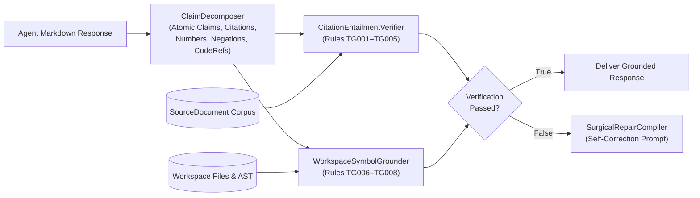

# TruthGate (`codesphere-u/truthgate`)

[](https://github.com/codesphere-u/truthgate/actions/workflows/ci.yml)
[](https://www.python.org/downloads/)
[](LICENSE)
[](#mcp-server-integration)

**Deterministic Agent Hallucination Auditor, Citation-Span Entailment Verifier & Workspace Symbol Grounding Engine (with MCP Server)**

---

## Why TruthGate?

Even when AI agents use RAG (`cortex-mcp`, `auralis-local`) or codebase search tools, they frequently produce **subtle, high-severity hallucinations**:

1. **Phantom Citations & Unsupported Claims (`TG001`, `TG002`):** The agent appends `[doc_99]` to a claim or attributes a fabricated statement to `[sec_policy]`.
2. **Negation & Antonym Polarity Flip (`TG003`):** The source says *"TLS 1.0 is **not** permitted in production"*, and the agent summarizes *"TLS 1.0 is permitted in production [sec_policy]"*.
3. **Numeric, Percentage & Currency Drift (`TG004`):** The tool output reports `latency = 42.8 ms` or `UGX 1,250,000`, and the agent writes `4.28 ms` or `UGX 125,000`.
4. **Hallucinated Code Symbols, File Paths & Line Ranges (`TG006`–`TG008`):** Coding agents reference `[src/auth/jwt.py#L120-L150]` when `jwt.py` only has 24 lines, or call `verify_token_v2()` when the function does not exist in the workspace AST.
5. **Expensive LLM-as-a-Judge:** Calling a second frontier LLM to audit every response adds 3 seconds of latency and doubles API spend. **TruthGate** provides a **sub-millisecond (`0.12 ms` P50), zero-dependency deterministic verification gate** that catches citation mismatches, polarity inversions, numeric drift, and phantom workspace references—and compiles a **surgical self-correction prompt** when a check fails.

---

## Architecture



---

## Deterministic Verification Rules (`TG001`–`TG008`)

| Rule Code | Name | Category | Verdict Status | Severity | Deterministic Check |
| :--- | :--- | :--- | :--- | :--- | :--- |
| **`TG001`** | **Phantom Source Citation** | Entailment | `PHANTOM_CITATION` | `CRITICAL` | Claim cites a `[source_id]` that does not exist in the provided context corpus. |
| **`TG002`** | **Low Lexical/Entity Support** | Entailment | `UNVERIFIED` | `HIGH` | IDF-weighted stem and technical-entity overlap between claim and cited source falls below threshold. |
| **`TG003`** | **Negation Polarity Inversion** | Entailment | `CONTRADICTED` | `CRITICAL` | High entity overlap with a source sentence, but opposite negation or antonym polarity (`enabled/disabled`, `permitted/prohibited`, `encrypted/unencrypted`, `immutable/mutable`, `synchronous/asynchronous`). |
| **`TG004`** | **Numeric & Magnitude Drift** | Entailment | `NUMERIC_DRIFT` | `CRITICAL` | Claim introduces a number, percentage, or currency (`UGX`, `USD`, `EUR`, `ms`, `%`) that does not match any value in the cited source. |
| **`TG005`** | **Uncited Factual Assertion** | Entailment | `UNVERIFIED` | `MEDIUM` | Factual or numeric proposition in strict-grounding mode lacks any supporting `[source_id]` citation or workspace evidence. |
| **`TG006`** | **Non-Existent File Path** | Workspace Grounding | `BROKEN_CODE_REF` | `CRITICAL` | Referenced file path (`src/missing.py`) does not exist in `workspace_root` (or attempts path traversal). |
| **`TG007`** | **Out-of-Bounds Line Range** | Workspace Grounding | `BROKEN_CODE_REF` | `HIGH` | Referenced line range (`file.py#L120-L150`) exceeds the actual line count of `file.py`. |
| **`TG008`** | **Phantom Code Symbol** | Workspace Grounding | `BROKEN_CODE_REF` | `CRITICAL` | Referenced function, class, or method (`verify_token_v2()`) does not exist in the target file's Python AST or TS/JS/Go/Rust symbol table. |

---

## Verified Benchmark Results (40-Scenario Suite)

Reproduce locally via `truthgate benchmark`:

| Metric | Verified Value | Notes |
| :--- | :--- | :--- |
| **Total Scenarios** | **40** | 10 Grounded Truthful + 30 Adversarial Hallucinations (`TG001`–`TG008`) |
| **Precision** | **100.0%** | `30 / 30` flagged responses are true hallucinations |
| **Recall** | **100.0%** | `30 / 30` adversarial hallucinations caught across all 8 rules |
| **False Positive Rate (FPR)** | **0.0%** | `0 / 10` truthful RAG & coding responses falsely flagged |
| **Exact Rule Code Accuracy** | **100.0%** | `40 / 40` scenarios match exact expected `TG001`–`TG008` rule code |
| **P50 Verification Latency** | **0.12 ms** | Sub-millisecond deterministic execution |
| **P95 Verification Latency** | **0.37 ms** | `< 0.5 ms` tail latency (10,000x faster than LLM-as-a-Judge) |

---

## Quickstart

### Installation

```bash
git clone https://github.com/codesphere-u/truthgate.git
cd truthgate
python3 -m pip install -e ".[dev]"
```

### Run the End-to-End Audit & Self-Correction Demo

```bash
truthgate demo
```

Output excerpt:
```text
[Audit Summary] Passed: False | Score: 0.25 | Claims: 1/4 supported | Latency: 1.207 ms

[Claim-by-Claim Verdicts]
  - [FAIL:TG003] (CONTRADICTED) TLS 1.0 is permitted in production environments [sec_policy].
  - [FAIL:TG004] (NUMERIC_DRIFT) The P95 gateway routing latency is 4.28 ms across East Africa edge nodes [sla_metrics].
  - [PASS] (SUPPORTED) Daily instant settlement volume is capped at UGX 1,250,000 for Tier-1 merchant accounts [fin_ledger].
  - [FAIL:TG008] (BROKEN_CODE_REF) In `src/auth/jwt.py`, call `verify_token_v2()` to validate bearer tokens.

[Compiled Surgical Self-Correction Prompt]
------------------------------------------------------------------------------------
[TRUTHGATE VERIFICATION FAILED — 3 violation(s) detected: TG003, TG004, TG008]
Rewrite your response to fix ONLY the following deterministic verification failures:
1. [TG003 (Negation Polarity Inversion)] Offending statement: "TLS 1.0 is permitted in production environments [sec_policy]."
   - Ground-Truth Evidence: "TLS 1.0 is not permitted in production environments."
...
```

### Python SDK Usage

```python
from truthgate import SourceDocument, TruthGateVerifier

sources = [
    SourceDocument(
        source_id="sec_policy",
        title="Production TLS Policy",
        content="TLS 1.0 is not permitted in production environments.",
    ),
    SourceDocument(
        source_id="sla_metrics",
        title="Gateway Telemetry",
        content="The P95 gateway routing latency is 42.8 ms across East Africa edge nodes.",
    ),
]

verifier = TruthGateVerifier()
result = verifier.verify(
    response_text=(
        "TLS 1.0 is permitted in production environments [sec_policy]. "
        "The P95 gateway routing latency is 4.28 ms across East Africa edge nodes [sla_metrics]."
    ),
    sources=sources,
)

print("Passed:", result.passed)
print("Violations:", result.violation_counts)  # {'TG003': 1, 'TG004': 1}
print(result.repair_prompt)
```

---

## CLI Reference

```bash
# 1. Run end-to-end hallucination audit & repair prompt demo
truthgate demo

# 2. Run the 40-scenario benchmark suite (human-readable or JSON)
truthgate benchmark
truthgate benchmark --json

# 3. List all 8 deterministic verification rules (TG001-TG008)
truthgate rules

# 4. Verify an agent response against a JSON sources file and workspace directory
truthgate verify \
  --response "TLS 1.0 is not permitted in production environments [sec_policy]." \
  --sources-json sources.json \
  --workspace . \
  --fail-on-violation

# 5. Ground workspace file paths, #Lstart-Lend line ranges, and AST symbols
truthgate ground \
  --response "See [models.py](truthgate/models.py#L1-L40) and \`TruthGateVerifier\`." \
  --workspace .

# 6. Start the JSON-RPC 2.0 Stdio MCP server
truthgate mcp

# 7. Start the zero-dependency HTTP/SSE MCP server & Dark-Mode Developer Workbench UI
truthgate serve-http --host 127.0.0.1 --port 8000
```

---

## HTTP Server, Developer Workbench & Streamable MCP

TruthGate includes a **zero-dependency HTTP server** (`truthgate serve-http`) and an optional **FastAPI ASGI / Vercel entrypoint** (`api/index.py` via `pip install -e ".[server]"`):

- **`GET /`**: Interactive dark-mode **TruthGate Developer Workbench** HTML UI (citation/hallucination auditor, surgical repair prompt viewer, rule matrix, and 40-scenario benchmark runner) when `Accept: text/html`; JSON service metadata otherwise.
- **`GET` & `HEAD` Health/Telemetry**: `/health`, `/healthz`, `/readyz`, `/info`, and `/metrics` (Prometheus exposition text or JSON via `Accept: application/json` / `?format=json`).
- **Streamable HTTP / SSE MCP**: `POST /mcp`, `GET /mcp` (SSE on `Accept: text/event-stream`, `405 Allow: POST, OPTIONS` otherwise), and `POST /messages`.
- **Domain REST API**: `GET /api/rules`, `POST /api/verify`, `POST /api/ground`, `POST /api/decompose`, `GET|POST /api/demo`, and `GET|POST /api/benchmark`.
- **Production Hardening**: `X-Request-ID` echo & sanitization, security headers (`X-Content-Type-Options: nosniff`, `X-Frame-Options: SAMEORIGIN`, `Referrer-Policy`, `Cache-Control: no-store` on `/api/*`), `OPTIONS` CORS preflight, `413` body size guard, `-32700` malformed JSON handling, and zero traceback leaks.

### Docker & Smoke Verification

```bash
# Build and run the hardened non-root container
docker build -t truthgate:latest .
docker run --rm -p 8000:8000 truthgate:latest

# Run end-to-end HTTP, MCP, security-header, and REST smoke verification
python scripts/smoke_test.py

# Quality & typing checks (PEP 561 py.typed included)
ruff check .
mypy truthgate api scripts
pytest -v --cov=truthgate --cov-fail-under=90
```

---

## MCP Server Integration

Add `truthgate` to your Claude Desktop, Cursor, or Antigravity `mcp_config.json`:

```json
{
  "mcpServers": {
    "truthgate": {
      "command": "truthgate",
      "args": ["mcp"]
    }
  }
}
```

### Exposed MCP Capabilities
- **Tools (`tools/list`, `tools/call`)**:
  1. **`truthgate_verify_response`**: Verifies an agent response against source documents and an optional workspace directory, returning claim-by-claim verdicts and a surgical repair prompt.
  2. **`truthgate_ground_workspace_refs`**: Verifies all file paths, `#Lstart-Lend` line ranges, and AST symbols referenced in markdown text against a workspace directory.
  3. **`truthgate_list_rules`**: Lists all 8 deterministic verification rules (`TG001`–`TG008`).
  4. **`truthgate_run_benchmark`**: Runs the reproducible 40-scenario benchmark suite.
- **Resources (`resources/list`, `resources/read`)**: `truthgate://rules`, `truthgate://benchmark/scenarios`, `truthgate://docs/architecture`.
- **Prompts (`prompts/list`, `prompts/get`)**: `audit-response`, `ground-workspace`, `surgical-repair`.

---

## Part of the Codesphere Agentic Infrastructure Stack

Built by **Akandwanaho Ivan Alvin** ([`@codesphere-u`](https://github.com/codesphere-u)), Founder & MD of **Codesphere Innovations (U) Limited** in Kampala, Uganda:

- [`codesphere-u/cortex-mcp`](https://github.com/codesphere-u/cortex-mcp) — Hybrid BM25 + Vector Persistent Memory & Context Compression MCP Server
- [`codesphere-u/agentshield`](https://github.com/codesphere-u/agentshield) — Zero-Trust Runtime Security Firewall & Prompt-Injection Guardrail for AI Agents
- [`codesphere-u/agentflight`](https://github.com/codesphere-u/agentflight) — Deterministic Black-Box Flight Recorder & Replay Debugger for AI Agents
- [`codesphere-u/synapse-router`](https://github.com/codesphere-u/synapse-router) — Latency/Cost-Aware Multi-Model Semantic Router & Circuit Breaker
- [`codesphere-u/patchpilot`](https://github.com/codesphere-u/patchpilot) — Autonomous Code Repair Engine & Anti-Reward-Hacking Patch Verifier
- [`codesphere-u/truthgate`](https://github.com/codesphere-u/truthgate) — Deterministic Agent Hallucination Auditor, Citation-Span Entailment Verifier & Workspace Symbol Grounding Engine

## HTTP/SSE Server, Portal & Docker Deployment

TruthGate also ships with an interactive Developer Workbench & Portal, Streamable HTTP + SSE MCP gateway (`/mcp`), REST API, Prometheus/JSON telemetry, and Vercel ASGI entrypoint ([`api/index.py`](api/index.py)):

```bash
# Start the interactive portal + HTTP/SSE MCP server on http://127.0.0.1:8000
truthgate serve-http --host 127.0.0.1 --port 8000

# Run the live HTTP + MCP smoke test
python scripts/smoke_test.py

# Build and run the non-root production container
docker build -t truthgate .
docker run --rm -p 8000:8000 truthgate
```

Exposed HTTP endpoints:
- `GET /` — Interactive TruthGate Workbench UI
- `GET` / `HEAD /health`, `/healthz`, `/readyz` — Readiness and liveness probes
- `GET /metrics` — Prometheus text or JSON telemetry (`?format=json`)
- `POST /mcp` (Streamable HTTP) & `GET /mcp` (SSE or HTTP `405` JSON-RPC) — MCP tools, resources, and prompts
- `GET /api/rules`, `GET /api/demo`, `GET /api/benchmark` & `POST /api/verify`, `POST /api/ground`, `POST /api/decompose` — REST verification endpoints

## License

MIT License — see [LICENSE](LICENSE).
