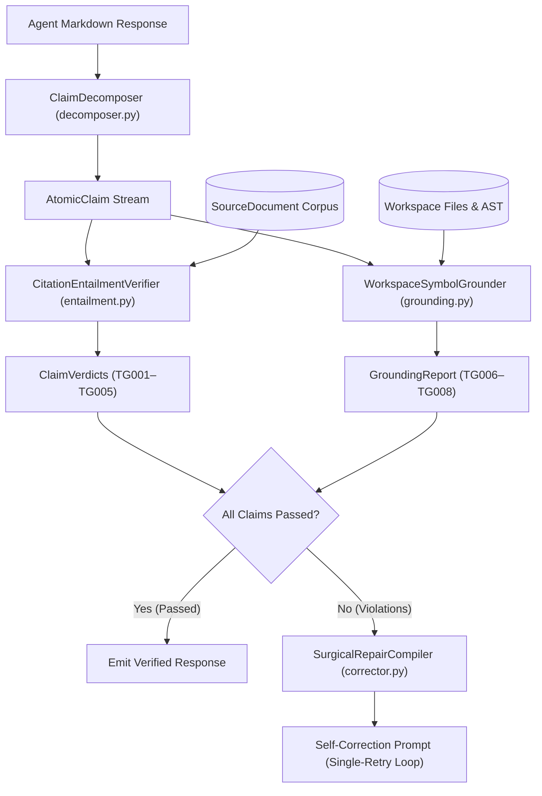

# TruthGate Architecture

## System Overview

**TruthGate** (`codesphere-u/truthgate`) is a sub-millisecond, zero-dependency verification gate for autonomous AI and coding agents. Instead of invoking a second frontier LLM ("LLM-as-a-Judge") that adds 2–4 seconds of tail latency and doubles inference costs, TruthGate decomposes responses into atomic propositions and verifies them deterministically against retrieved `SourceDocument` spans and workspace AST symbol tables.

## Core Subsystems

### 1. Atomic Claim Decomposer (`truthgate/decomposer.py`)
- Splits multi-paragraph markdown responses into sentence-level propositions while protecting abbreviations (`e.g.`, `i.e.`, `vs.`) and numeric decimals (`42.8 ms`, `$1,250.00`).
- Extracts inline citations (`[doc_1]`, `[source:sec_1]`, `(ref: doc_2)`), normalized `NumericToken` objects (currencies `UGX`, `USD`, `EUR`, percentages, latency/storage/throughput units, and protocol versions), negation particles, technical entities, and `CodeReference` spans (`[label](path#L10-L20)`, `[path#L10-L20]`, backtick paths, and AST symbol invocations).

### 2. Citation-Span Entailment Verifier (`truthgate/entailment.py`)
- Evaluates each `AtomicClaim` across rules `TG001`–`TG005`:
  - **`TG001` (Phantom Source Citation):** Rejects citations to non-existent `source_id` keys.
  - **`TG002` (Low Lexical/Entity Support):** Computes IDF-weighted stem and technical-identifier overlap against sentences in the cited `SourceDocument`.
  - **`TG003` (Negation Polarity Inversion):** Computes algebraic polarity across explicit negation tokens (`not`, `never`, `cannot`, `without`, `zero`) and 30+ bidirectional technical antonym pairs (`enabled/disabled`, `permitted/prohibited`, `encrypted/unencrypted`, `immutable/mutable`, `synchronous/asynchronous`). Correctly resolves double-negatives (`"not disabled"` == `"enabled"`) without false positives.
  - **`TG004` (Numeric & Magnitude Drift):** Verifies that every numeric literal, percentage, and currency amount in the claim matches a ground-truth `NumericToken` in the cited source.
  - **`TG005` (Uncited Factual Assertion):** Flags factual propositions lacking any citation in strict-grounding mode.

### 3. Workspace Symbol Grounder (`truthgate/grounding.py`)
- Evaluates `CodeReference` items across rules `TG006`–`TG008`:
  - **`TG006` (Non-Existent File Path):** Verifies file existence and enforces path-traversal containment inside `workspace_root`.
  - **`TG007` (Out-of-Bounds Line Range):** Checks `#Lstart-Lend` bounds against actual file line counts.
  - **`TG008` (Phantom Code Symbol):** Parses Python files with `ast.parse` (extracting functions, async functions, classes, `Class.method` bindings, and module constants) and indexes TypeScript/JavaScript/Go/Rust symbols.

### 4. Surgical Repair Compiler (`truthgate/corrector.py`)
- Synthesizes a compact, token-efficient **Self-Correction Prompt** containing only the failed claims, their `TG001`–`TG008` violation codes, and verbatim ground-truth evidence spans or AST symbol lists.
